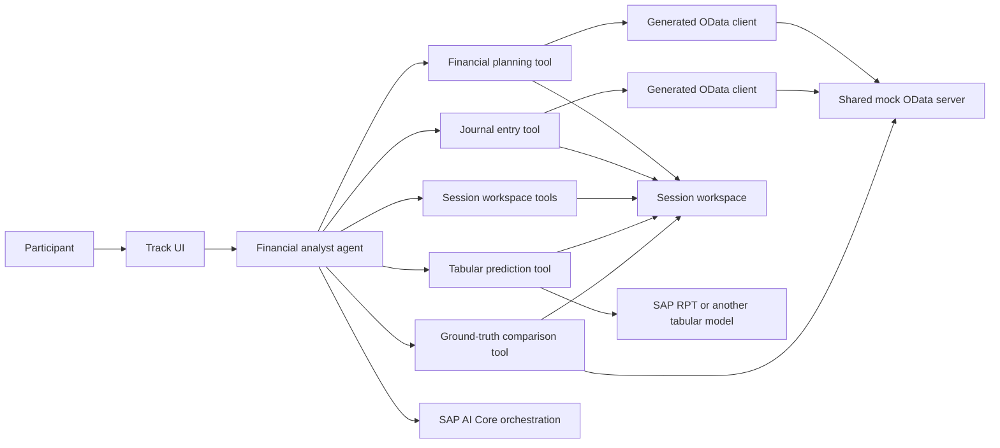

# RA160 Demo Story

## Working title

**Build a Financial Planning Agent You Can Verify**

## One-line pitch

Build an AI financial analyst that retrieves SAP business data through generated OData clients, answers factual questions with SQL, predicts unknown values with a tabular model, and validates those predictions against actuals excluded from the prediction input.

## Why this story

The workshop should not end with an agent producing a plausible paragraph.
It should end with participants being able to explain where every number came from, why a prediction was necessary, and how well that prediction matched reality.

The progression is therefore an evidence ladder:

1. Retrieve business data from SAP-style OData services.
2. Compute answers from known data with deterministic SQL.
3. Use a tabular prediction model only when the requested value is not present in the data.
4. Compare the prediction with actual data that the prediction did not receive.
5. Expose the tool activity so the result is inspectable.

This follows the successful shape of TechEd 2025 AI160: one business scenario, a working application from the beginning, progressively enabled agent capabilities, and parallel JavaScript and Java tracks.
RA160 changes the business problem from purchase-order escalation to financial analysis and raises the bar from tool use alone to measurable prediction quality.

## Business scenario

A financial controller is preparing a review for cost center `A1000`.
They need to answer three increasingly difficult questions:

1. **What did we plan and spend?**
2. **What should we expect in a future period?**
3. **How accurate is that forecast when compared with the actual result?**

The controller asks these questions in natural language.
The agent decides which business data and tools it needs, but deterministic components remain responsible for data retrieval, calculation, prediction, and evaluation.

The final experience should make a clear distinction:

- If the answer already exists in the data, query and aggregate it.
- If the answer is missing, predict it with the configured tabular model.
- If ground truth is available, measure the prediction rather than merely trusting it.

## Learning outcomes

By the end of the workshop, participants can:

- Connect an AI agent to SAP OData services through generated SAP Cloud SDK clients.
- Define agent tools with clear, typed inputs and useful descriptions.
- Use a session-scoped analytical workspace for joins and aggregations.
- Distinguish reporting from prediction.
- Invoke a tabular foundation model for a regression task, using SAP RPT as the initial backend.
- Evaluate a forecast against actuals excluded from the prediction input using understandable percentage metrics.
- Inspect the agent's tool calls and intermediate results.
- Recognize which parts of the solution are shared concepts and which are language-specific implementation details.

## Target format

- **Duration:** 120 minutes: a 5-minute opening demo, a 105-minute workshop flow, and a 10-minute buffer.
- **Format:** Hands-on workshop with a short opening and closing demonstration.
- **Tracks:** JavaScript initially; Java added later with the same outcomes.
- **Audience:** Application developers familiar with JavaScript/TypeScript or Java, but not necessarily with agent frameworks or financial forecasting.
- **Public use:** Followable after the event on a participant's own machine with their own SAP AI Core credentials.

## Story alternatives considered

### Evidence ladder — recommended

The proposed story moves from known data to prediction and then to validation.

**Strengths:**

- Uses every distinctive capability already present in the repository.
- Gives the workshop a defensible conclusion by measuring the forecast instead of trusting its wording.
- Creates a clear progression in which each exercise adds one visible capability.
- Keeps SAP data access, deterministic calculation, model prediction, and evaluation conceptually separate.

**Weaknesses:**

- Requires participants to understand two OData services, generated clients, a session database, agent tools, tabular prediction, and evaluation metrics in two hours.
- Depends on SAP AI Core and a tabular-model backend being available during the central exercise.
- Uses a workflow convention rather than technical enforcement to exclude evaluation actuals from the prediction input.
- Risks making infrastructure more memorable than the business decision.

The workshop must therefore provide the UI, data model, generated clients, and most infrastructure as working reference code.
Hands-on work should focus on tool contracts and orchestration rather than plumbing.

Choose this approach when tabular prediction and trustworthy agent behavior are the primary session messages, with SAP RPT providing the initial model backend.

### Budget-planning copilot

The controller could build a proposed budget, compare it with prior spend, and explain recommended allocations.
This creates a strong business narrative and naturally supports a later approval or write-back step.

The weakness is conceptual ambiguity.
Planning data already contains BUDGET, FORECAST, ACTUAL, and PLAN categories, so participants may struggle to distinguish source values from model-generated recommendations.
The story can also drift toward autonomous financial decisions, which would require governance and human approval beyond the current scope.

Choose this approach for a longer workshop centered on planning decisions rather than prediction evaluation.

### Financial-close investigation

The agent could investigate unusual monthly spend, trace it to journal entries, and explain the variance from plan.
This path is deterministic, operationally reliable, and easy to complete in two hours.

Its weakness is that tabular prediction becomes optional or artificial.
The workshop would demonstrate OData, tool calling, and analytical reasoning well, but it would lose the strongest differentiator of the current implementation.

Choose this approach if workshop reliability matters more than showcasing prediction.

### Cross-language SDK lab

JavaScript and Java attendees could implement the same small tool and compare framework integration patterns.
This makes SDK parity explicit and limits business-domain complexity.

Its weakness is a fragmented participant story.
Most attendees use only one language, and implementation comparison does not provide the same business payoff as a forecast that can be evaluated.

Choose this approach for an enablement session aimed at SDK maintainers or partners, not as the default RA160 workshop.

## Analysis architecture alternatives

### Session SQL workspace — recommended

Load filtered OData rows into session-scoped tables and let the agent use SQL for joins and aggregation.

**Strengths:**

- Supports cross-service analysis without expanding the mock OData contract.
- Keeps arithmetic deterministic and inspectable.
- Reuses the current JavaScript implementation.
- Stores tabular prediction output in the same analytical workflow.
- Supports a transparent SQL forecast baseline that can be evaluated beside the configured tabular model.

**Weaknesses:**

- Introduces database concepts that are not the workshop's main subject.
- Copies source data into process memory.
- Requires the Java track to choose and explain an equivalent analytical store.
- Needs lifecycle and cleanup behavior so one participant's session does not affect another.

### OData query pushdown

Perform filters, joins, and aggregations through OData wherever possible.

**Strengths:**

- Reduces transferred data and local state.
- Keeps computation close to the business service.
- Resembles production query optimization when the service supports the required operations.

**Weaknesses:**

- The decisive limitation is post-prediction analysis: RPT results are session-local rows, not entities exposed by either OData service, so OData cannot reliably regroup them into quarterly or other business-level totals.
- Making prediction results queryable through OData would require persistence or a new temporary-result endpoint, which adds write-back, lifecycle, and provenance concerns.

- The current mock server supports `$filter`, `$select`, `$orderby`, and `$top`, but not general aggregation through `$apply`.
- A join between the two service roots is not available as one ordinary OData query.
- Extending the mock server would consume workshop-development effort without teaching more about agents or tabular prediction.
- Agent-authored OData expressions are harder for participants to inspect and debug than the limited typed filters followed by SQL.

Use OData pushdown to reduce source data before loading it into the workspace, not as the sole analysis layer for a workflow that must reshape and aggregate prediction results.

### Sandboxed code interpreter

Load data into a sandbox and let the agent generate JavaScript for transformations, for example through a QuickJS interpreter.

**Strengths:**

- Handles transformations that are awkward to expose as individual tools.
- Can feel natural to developers who already know JavaScript.
- Avoids introducing SQL as another layer of syntax and semantics.

**Weaknesses:**

- Adds sandboxing, execution limits, dependency restrictions, and error-reporting requirements.
- Generated code is less predictable and harder to compare across JavaScript and Java tracks.
- Provenance becomes weaker unless every input, generated program, and output is surfaced.
- Passing all rows through model context would increase cost and risk; data should remain in the sandbox and be referenced by name.

Choose this approach only as an advanced extension focused on code execution.

### Purpose-built business tools

Replace general SQL with tools such as `get_monthly_spend`, `get_quarterly_budget`, and `compare_forecast`.

**Strengths:**

- Offers the smallest and safest model action space.
- Produces highly repeatable workshop results.
- Maps cleanly to equivalent Java and JavaScript implementations.

**Weaknesses:**

- Requires a new tool for each analytical question.
- Hides how one set of retrieved rows can support several follow-up questions.
- Makes the agent look like a router over predefined reports rather than a composable analyst.

Choose this approach if deterministic execution and minimal runtime dependencies outweigh analytical flexibility.

## Weaknesses and mitigations of the recommended story

| Weakness or risk | Consequence | Mitigation |
| --- | --- | --- |
| The two-hour scope combines many concepts. | Participants can spend the session wiring infrastructure instead of learning the agent decisions. | Ship the UI, mock data, generated clients, and workspace implementation; limit edits to focused tool registration and prompts. |
| Access to the configured tabular model, initially SAP RPT, can fail because of credentials, entitlements, or model availability. | A participant cannot complete the central prediction step. | Document a preflight check and troubleshooting path before Exercise 1; verify event accounts before the session. |
| Tabular-model output can vary between runs or model versions. | Screenshots and exact-number instructions become brittle. | Assert the output shape and evaluation flow, not exact forecast values; use fixed source years and dimensions. |
| The current code exposes separate single-source and dual-source RPT tools. | Participants see transport shape as two business capabilities, and another tabular backend would require provider-specific tool names. | Consolidate them behind one provider-neutral `run_tabular_prediction` contract before creating exercise branches. |
| The mock actuals are queryable even though the exercise excludes them from prediction. | “Ground truth” may sound like a technically enforced blind test when it is only a workflow convention. | State explicitly that the exercise excludes those rows from the configured model input but the server does not restrict access. |
| Planning categories and signed journal amounts are domain-specific. | Participants can produce totals that are four times too large or compare positive budgets with negative expenses incorrectly. | Provide fixed prompts, explain category filters, and use magnitude-aware comparison metrics. |
| The local SQL workspace may dominate the story. | Participants may mistake DuckDB for a required SAP AI architecture component. | Describe it as a replaceable implementation detail and keep the learning objective on deterministic computation. |
| The forecasting-specific SQL guard prevents a direct baseline comparison. | The workshop cannot show whether the tabular model improves on a simple statistical or carry-forward forecast. | Remove the forecasting ban, retain a read-only SQL boundary, label the generated method, and evaluate both outputs against identical actuals. |
| A shared Node.js mock server adds a second toolchain to the Java track. | Java participants face setup work unrelated to their chosen language. | Start with a documented common prerequisite; package the server as a one-command artifact if setup data shows it is a barrier. |
| The current repository is a completed reference implementation, not staged exercise material. | Simply publishing the current tree does not create the progressive workshop experience. | Build explicit starter and solution states before publication, and test every transition from a clean checkout. |
| Tool activity can overwhelm the chat UI. | The evidence trail can distract from the business result. | Use concise labels by default and reveal arguments or raw results only when participants inspect a step. |

## Decision guardrails

- Keep ground-truth evaluation in the core; it is the payoff of the evidence-ladder story.
- Permit transparent SQL forecasting as a labeled baseline, not as an unlabeled substitute for the configured tabular model.
- Compare SQL and tabular-model outputs at the same grain and do not assume that either method wins.
- Remove optional model experiments, view management, or extra prompts before cutting validation.
- Do not add file upload unless the core flow consistently finishes with the 10-minute buffer intact.
- Do not duplicate the mock data implementation for Java; package or document the shared server instead.
- If SAP RPT cannot be provisioned reliably for participant-owned accounts, configure another supported tabular-model backend or choose the financial-close story rather than simulating a prediction.
- If Java cannot match the local SQL implementation economically, preserve the observable tool and metric contract instead of forcing internal parity.

## Architecture



### Component responsibilities

| Component | Responsibility |
| --- | --- |
| Shared mock OData server | Serve financial planning and journal-entry APIs from one deterministic financial truth model. |
| Generated OData clients | Provide typed access to the two OData services. |
| Financial agent | Interpret the request and select the appropriate tools. |
| Session workspace | Hold fetched rows, views, and prediction results for the current conversation. |
| Session workspace tools | Query loaded data with SQL, save reusable views, and clean up tables or views. |
| Tabular prediction tool | Send normalized context and prediction rows to the configured model backend and store the resulting values. |
| Ground-truth tool | Load comparison actuals that the prediction did not receive and calculate forecast-quality metrics. |
| Activity UI | Show tool calls and outcomes without exposing framework-specific internals as the main lesson. |

### Tabular-model boundary

The workshop-facing agent should expose one provider-neutral `run_tabular_prediction` tool.
Its input should identify a context table and optional filter, a prediction table and optional filter, the target column, task type, and output table.
The context and prediction sources may refer to the same table or to different tables.

The current JavaScript implementation exposes `run_rpt_prediction` for one table and a separate dual-source variant for two tables.
Consolidating them behind the single contract is low-hanging preparation work, not a participant exercise.

An application-level adapter should select the tabular model backend.
SAP RPT is the initial and demonstrated backend, but the agent tool name, inputs, session-table output, and validation flow should not depend on it.
Do not let the chat model choose the provider from the user prompt; deployment policy and configuration should make that decision.

This boundary leaves room for another tabular model without changing prompts, exercises, SQL aggregation, ground-truth comparison, or the Java parity contract.

## Shared server and language tracks

The mock OData server and EDMX specifications should remain top-level, language-neutral workshop infrastructure.
JavaScript and Java should consume the same service URLs and the same deterministic data over HTTP.

A future repository shape could be:

```text
.
├── mock-server/          Shared OData server and canonical mock truth
├── specs/                Shared EDMX service definitions
├── js-app/               JavaScript/TypeScript track
├── java-app/             Java track, added later
└── exercises/
    ├── javascript/       Track-specific instructions
    └── java/             Conceptually equivalent instructions
```

The two tracks should share:

- The business scenario.
- Service contracts and sample data.
- Exercise boundaries.
- Sample prompts.
- Expected business outcomes.
- Names for the main tool concepts.
- The final validation metrics.

They do not need identical internal architecture.
The JavaScript track can use LangChain/LangGraph integrations and DuckDB, while the Java track can use the SAP Cloud SDK for AI with Spring AI and an appropriate local analytical store.
Framework mechanics should serve the common learning outcomes rather than force artificial code parity.

Only the OData server should be shared initially.
A shared UI or agent HTTP protocol can be considered later, but should not block the Java track.
Track-owned UIs are acceptable if they present the same prompts, tool activity, and final business result.

Sharing the server must not hide a second toolchain requirement.
Initially, the Java track may document Node.js and pnpm as common workshop prerequisites and run the server as a separate process.
If that setup becomes a barrier, package the same server and data as a prebuilt container or other one-command artifact rather than creating a second Java mock implementation that can drift.

## Workshop flow

### Preparation — start from a working application

**Time:** 10 minutes

Participants:

1. Choose the JavaScript track, with Java available later.
2. Install dependencies.
3. Provide SAP AI Core credentials through a local environment file.
4. Start the shared mock OData server and track application.
5. Open the financial-agent UI.

The current repository is a finished reference implementation with all tools enabled.
Workshop authoring must create staged starter states in which the agent exposes only the capabilities needed for the current exercise.
As in AI160, exercise solutions may be present as clearly marked commented sections or in separate solution references, while the primary instructions ask participants to make the changes themselves.

Before editing code, briefly inspect:

- The financial planning service.
- The journal-entry service.
- The generated client for each service.
- The activity rail in the UI.

**Baseline message:** The model is not the source of financial truth.
SAP business data and deterministic tools are.

### Exercise 1 — turn SAP data into an answer

**Time:** 25 minutes

**Goal:** Enable the agent to retrieve financial data and answer reporting questions.

Participants wire the following capabilities into the agent:

- Query financial planning entries.
- Query journal entries.
- Run SQL over data loaded into the session workspace.

The finished reference implementation also provides the `create_view` and `drop_table` tools for reusable transformations and workspace cleanup.

Suggested prompts:

```text
Show me the quarterly budget for cost center A1000 for fiscal year 2025.
```

```text
Show me the monthly actual spend for cost center A1000 for fiscal year 2025.
```

Expected visible flow:

1. The agent selects the relevant OData tool.
2. The generated client sends a filtered request to the shared server.
3. Rows are loaded into a named session table.
4. SQL aggregates them to the requested month or quarter.
5. The answer names the source, filter, period, and aggregate.
6. The activity rail shows the OData and SQL steps.

Important teaching points:

- OData filtering limits the data retrieved from the business service.
- SQL performs deterministic arithmetic and aggregation.
- Planning categories must be filtered deliberately; loading all categories can multiply totals.
- Journal expenses are signed values, so comparisons to positive planning amounts use their magnitude.
- The agent chooses tools, but it does not perform financial arithmetic in prose.

The [analysis architecture alternatives](#analysis-architecture-alternatives) section compares session SQL with OData pushdown, a sandboxed code interpreter, and purpose-built business tools.

**Checkpoint:** Participants can explain why this request does not require a prediction.

### Exercise 2 — predict what the data cannot answer

**Time:** 30 minutes

**Goal:** Add tabular prediction and forecast values for a fixed future period.

Participants register and use the provider-neutral tabular prediction tool, configured to use SAP RPT in the reference implementation.
Historical actuals provide known context.
Planning rows define the dimensions for which target values should be predicted.

The current implementation offers `run_rpt_prediction` for a single session table and a separate dual-source variant for separate context and prediction tables.
Before producing exercise branches, consolidate these behind the `run_tabular_prediction` contract described in the [tabular-model boundary](#tabular-model-boundary).
The core scenario supplies journal actuals and planning targets as separate sources.

The exercise should use fixed fiscal years and periods rather than phrases such as “next year.”
This keeps a public, self-guided workshop reproducible after 2026.

Suggested prompt:

```text
For cost center A1000, use journal entries from fiscal years 2022 through 2025 as actuals and forecast the monthly amount for fiscal year 2026. Summarize the result by fiscal period.
```

Expected visible flow:

1. The agent loads historical journal entries as context.
2. It loads the target planning rows for the forecast period.
3. SQL aggregates both sources to one row per fiscal year, fiscal period, G/L account, and ledger.
4. It invokes `run_tabular_prediction` for those account-month rows.
5. SQL sums account-level predictions into the twelve monthly totals.
6. The UI shows retrieval, preparation, prediction, and aggregation as distinct steps.

The low-data variant keeps only fiscal year 2025 for `A1000` model context and supplies 2022–2025 histories from the three peer entities. Shared account/month/cycle shapes and stable entity scales let the model transfer structure; the aggregate baselines still receive all four `A1000` years, making the comparison conservative.

Important teaching points:

- Reporting asks for values already present; forecasting asks for values not included in the prediction input.
- SQL may produce an explicitly labeled baseline forecast for comparison, but it must not be presented as observed fact.
- The configured tabular model receives structured context, not an unbounded prose prompt asking the LLM to guess a number.
- The prediction output is stored and queried like other session data.
- The primary forecast must come from the configured tabular model; an optional SQL baseline should be stored and evaluated separately rather than blended into the result.

**Checkpoint:** Participants can identify the context rows, prediction rows, target column, and output grain.

### Exercise 3 — verify before trusting

**Time:** 30 minutes

**Goal:** Compare the forecast with actuals that were excluded from the prediction input and communicate its quality.

Participants enable the ground-truth comparison tool.
The shared mock server derives both planning ACTUAL rows and journal postings from one canonical truth model.
The workshop excludes the selected actuals from the tabular-model input, then queries them through the same OData services only during evaluation; the server does not technically restrict earlier access.

Suggested follow-up prompt in the same session:

```text
Compare that forecast with the journal-entry ground truth for fiscal year 2026. Show forecast as a percentage of actual spend and identify the periods furthest below or above actual.
```

Expected visible flow:

1. The agent reuses the prediction table from Exercise 2.
2. The ground-truth tool retrieves actual journal entries for the same dimensions.
3. Predictions and actuals are aggregated to the same grain and joined.
4. The comparison table records predicted values, actual magnitude, and percentage metrics.
5. SQL identifies the strongest and weakest periods.
6. The final answer leads with percentages and clearly labels forecast and actual values.

Primary metrics:

- `pct_of_actual`: Forecast divided by the magnitude of actual spend.
- `pct_below_actual`: Percentage by which the forecast underestimates spend.
- `pct_above_actual`: Percentage by which the forecast overestimates spend.
- MAPE: Mean absolute percentage error across matched rows.

Important teaching points:

- A fluent forecast is not evidence of a good forecast.
- Prediction and ground truth must use the same filters and aggregation grain.
- Signed journal expenses require magnitude-aware comparisons.
- Validation is part of the agent workflow, not an offline afterthought.

**Checkpoint:** Participants can state both the forecast and how close it was to the evaluation actuals.

### Wrap-up and extension discussion

**Time:** 10 minutes

Return to the three controller questions:

1. Known plan and spend were answered with OData and SQL.
2. Unknown future values were predicted with the configured tabular model.
3. Forecast quality was measured against actuals excluded from the prediction input.

Close by inspecting the complete activity rail.
The final architecture should now be understandable as a composition of small tools with explicit data boundaries rather than a single opaque agent call.

## Opening demo

The five-minute opening demo is included in the 120-minute schedule and precedes the hands-on preparation:

1. Ask for the 2025 monthly actual spend for `A1000`.
2. Ask for the 2026 monthly forecast.
3. Ask the agent to validate that forecast against 2026 ground truth.
4. Expand the activity rail and point out the transition from OData to SQL to tabular prediction to validation.

Do not explain every implementation detail during the opening.
The purpose is to establish the destination and the business question participants will learn to solve.

## Expected final answer shape

The exact numbers depend on the deterministic mock data and configured tabular-model response, but the answer structure should be stable:

```text
For cost center A1000, the 2026 forecast totals <FORECAST_AMOUNT>.
That is <PERCENT_OF_ACTUAL>% of actual spend, or <PERCENT_BELOW_OR_ABOVE>% below/above actual.

| Period | Forecast | Actual magnitude | % of actual | % below | % above |
| --- | ---: | ---: | ---: | ---: | ---: |
| 001 | ... | ... | ... | ... | ... |

The largest under/overestimate occurred in period <PERIOD>.
Source: journal-entry actuals; prediction: configured tabular model; reference backend: SAP RPT; aggregation: fiscal period.
```

This format makes provenance and quality part of the business answer.

## Java parity contract

When the Java track joins the repository, it should reproduce observable behavior rather than line-by-line implementation.

For each exercise, both tracks must:

1. Begin from an equivalent visible application state.
2. Expose tools with the same business purpose.
3. Use the same OData endpoints and fixed data filters.
4. Run the same sample prompts.
5. Produce the same table grain and metric definitions.
6. Show enough tool activity to explain the result.
7. End with the same participant checkpoint.

Document framework-specific differences directly in each track.
Keep shared conceptual explanations at the repository or exercise overview level to prevent the JavaScript and Java narratives from drifting.

## Public and self-guided requirements

The public repository should work outside the event without temporary SAP systems other than services the participant explicitly supplies.

Required:

- Documented Node.js/pnpm and, later, Java/Maven versions.
- One command to start the shared mock OData server.
- One command to start each track application.
- `.env.example` files containing variable names but no credentials.
- Instructions for using a participant-owned SAP AI Core service key.
- Fixed, copyable prompts for every checkpoint.
- Expected output descriptions that do not rely on screenshots alone.
- Deterministic mock business data across workshop runs.
- Troubleshooting for ports, credentials, model availability, and server connectivity.
- A clear statement that the mock data and predictions are for learning, not business decisions.

Event-specific credentials may be described as a convenience, never as the only supported path.

## Optional extensions

Optional work should come only after the core validation flow is complete.

### SQL forecast baseline

Allow the agent to create a transparent aggregate forecast with SQL, such as a global mean, seasonal moving average, or simple regression.
Store the baseline in its own session table and compare it with the tabular-model output against the same actuals, filters, and aggregation grain.

The deterministic mock data combines account-specific seasonality and trends with a recurring ledger-adjustment cycle.
Aggregate-only methods cannot see that row-level interaction; RPT and TabPFN receive the ledger and account dimensions and should materially outperform both the naive mean and seasonal SQL baselines.
Expose the generated SQL, label every method, and report the measured MAPE rather than relying on an unverified quality claim.


### Model harmonization and prompt caching

The current JavaScript implementation already configures model fallback and prompt-caching middleware.
An optional exercise can let participants inspect or modify this configuration, change the orchestration models without changing agent or tool code, and observe whether the business workflow remains stable.
Explain prompt caching as an operational optimization, not a change to the financial result.

### File upload as an additional data source

A useful advanced scenario would let the controller upload a CSV file containing a local adjustment, target, or cost-center mapping.
The agent would load it into the session workspace and join it with OData-derived data.

Example prompt:

```text
Compare the uploaded departmental targets with the 2026 forecast and show the largest gaps.
```

This extension should not be part of the two-hour core workshop.
It requires:

- A file-upload UI and API.
- CSV parsing and schema handling.
- Size and type limits.
- Source naming and provenance in the answer.
- Session-scoped storage and cleanup.
- Clear rules for conflicts between uploaded values and SAP data.

If implemented, keep it read-only and session-local.
Do not let uploaded files silently override OData data.
Treat the file as another explicitly named source that the agent may join through SQL.

## Deliberate non-goals

The core workshop does not need:

- Autonomous write-back to an SAP system.
- Generic document ingestion or retrieval-augmented generation.
- Arbitrary file formats.
- Multiple tabular-model backends in the core workshop.
- Unlabeled ad hoc SQL presented as an authoritative forecast.
- Multi-agent orchestration.
- A shared JavaScript/Java UI before a stable common protocol exists.
- Production authentication, authorization, or persistence.
- Exhaustive model benchmarking.

These additions would dilute the central lesson: retrieve trusted data, compute known answers deterministically, predict only missing values, and verify the result.

## Success criteria

The workshop story succeeds when a participant can complete one language track in two hours and demonstrate all of the following:

1. A factual financial question is answered from OData data through SQL.
2. A future value is produced by the configured tabular model rather than fabricated by the LLM.
3. The prediction is compared at the same grain with actuals that were excluded from its input.
4. The result communicates forecast quality with percentage metrics.
5. The UI reveals the tools and data transitions used to produce the answer.
6. The same scenario can later be implemented in Java against the shared OData server without changing the business contract.
