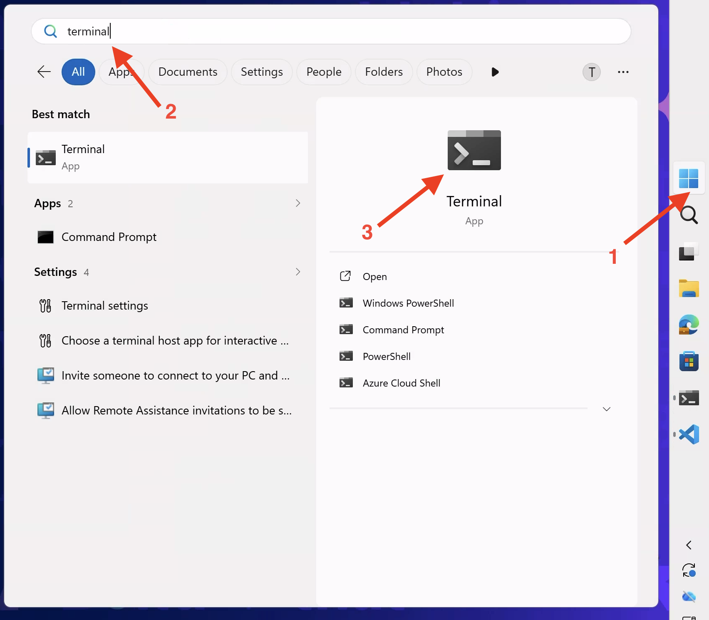
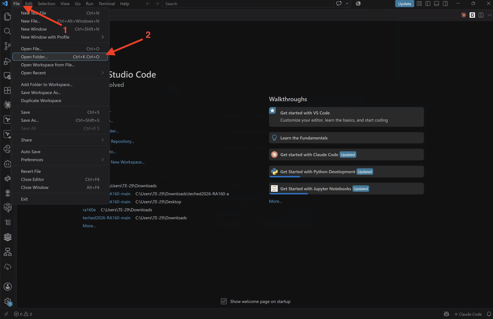
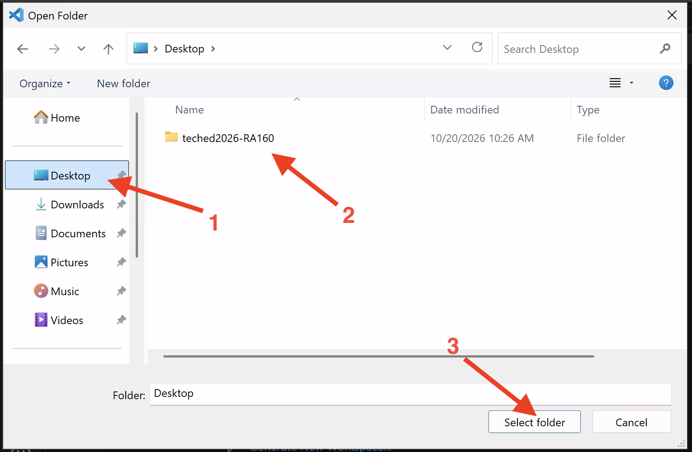
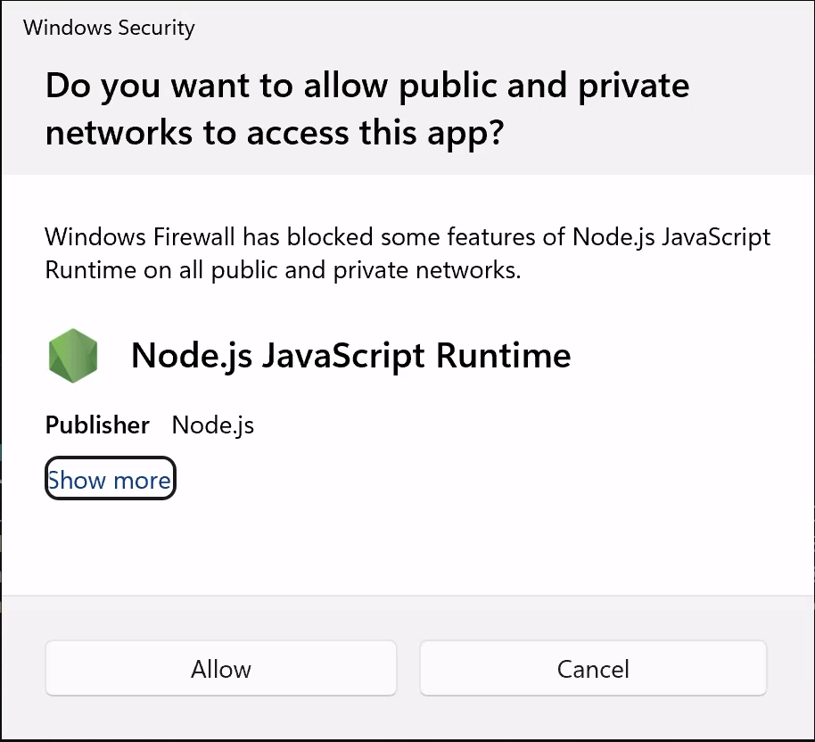

[](https://api.reuse.software/info/github.com/SAP-samples/teched2026-RA160)

# RA160 - Build business differentiation with SAP AI Core

## Description

This repository contains the material for the SAP TechEd 2026 session **RA160 – Build business differentiation with SAP AI Core**.

Experience SAP AI Core as the orchestration layer for enterprise AI. Our engineers help you extend Joule Agents with models from SAP Cloud SDK for AI, ground them in products for SAP Business Data Cloud, and embed them in the flows of SAP S/4HANA. Learn to govern, scale, and monitor AI agents from prototype to production.

In this workshop, you will build a financial data agent that queries a mock S/4HANA OData backend, stores the results in a local scratch database, and uses RPT / TabPFN on SAP AI Core to forecast future periods — all wired together through the [orchestration service](https://help.sap.com/docs/ai-launchpad/sap-ai-launchpad/orchestration-4953dc10c6dd48fe85f37b41109dffe2?locale=en-US&q=orchestration). 
Implementations are provided in both **TypeScript** (LangChain + SAP Cloud SDK for AI) and **Java** (Spring AI + SAP Cloud SDK for AI).

## Overview

The agent follows a deliberate reasoning pattern:

1. **Load** — OData tools call the mock S/4HANA services and stage the rows in a per-session in-memory workspace.
2. **Analyse** — An SQL tool runs deterministic filtering, joins, and aggregations over the staged data.
3. **Predict** — Forecasting tools submit the workspace tables to RPT / TabPFN on SAP AI Core and retrieve predictions.
4. **Evaluate** — A ground-truth tool re-fetches actuals from the mock backend and compares them against the forecast.

## Requirements

- Node.js 24 and pnpm 12 or 11 (Both Java and JavaScript exercises)
- Java 21 and Maven 3.9+ or the included Maven wrapper (Java exercises)
- Access to SAP AI Core / Generative AI Hub

## Getting Started

### Clone the Repository

Clone the repository using  the Git command line interface.
For this, open Powershell by clicking on the Windows icon in the task bar and writing `terminal` in the search bar.
Click on the terminal app icon to open it.



Now run the following commands in the terminal:

```bash
cd .\Desktop\
git clone https://github.com/SAP-samples/teched2026-RA160.git
```

This should create a folder with the name `teched2026-RA160` with the demo material on your desktop. 

In the terminal, you can now move into the new folder via the following command. 
You will install the requirements from here once you choose a programming language (in the next step). 

```bash
cd .\teched2026-RA160\
```

Now, open _Visual Studio Code_ via the icon on your Desktop.
In Visual Studio Code, click `File --> Open Folder...` and an Explorer window should open.



In the Explorer, click on `Desktop` in the left-hand side panel and then click on the folder named `teched2026-RA160` and `Select folder`.
The demo material should now open in Visual Studio Code.




### Select Your Programming Language

Choose between [JavaScript](js-app/exercises/README.md) or [Java](java-app/exercises/README.md) by clicking the respective links and continuing there.

> Note: If at any point during the demo a pop-up like the following appears, simply click on `Allow`.


## Contributing
Please read the [CONTRIBUTING.md](./CONTRIBUTING.md) to understand the contribution guidelines.

## Code of Conduct
Please read the [SAP Open Source Code of Conduct](https://github.com/SAP-samples/.github/blob/main/CODE_OF_CONDUCT.md).

## How to obtain support
Support for the content in this repository is available during the actual time of the online session for which this content has been designed. Otherwise, you may request support via the [Issues](https://github.com/SAP-samples/teched2026-RA160/issues) tab.

## License
Copyright 2026 SAP SE or an SAP affiliate company and teched2026-RA160 contributors. Please see our [LICENSE](LICENSES/Apache-2.0.txt) for copyright and license information. Detailed information including third-party components and their licensing/copyright information is available [via the REUSE tool](https://api.reuse.software/info/github.com/SAP-samples/teched2026-RA160).
