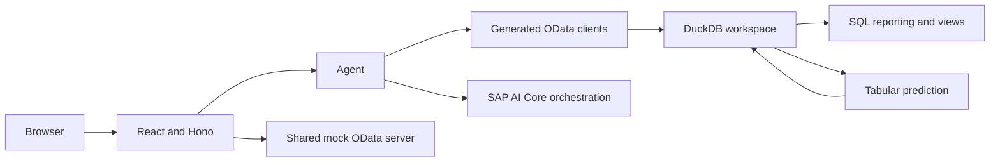

# JavaScript Developer Guide

This guide helps maintainers run, understand, and change the JavaScript reference application.
See [`DEMO_STORY.md`](../DEMO_STORY.md) for the workshop narrative, alternatives, and Java parity contract.
See the [repository README](../README.md) for participant-facing setup.

## Quick start

Prerequisites:

- Node.js 24.
- pnpm 12.
- mise as the tool manager and task runner.
- SAP AI Core credentials for orchestration and prediction calls.

Install dependencies from the repository root:

```bash
pnpm install
```

Keep credentials in the root `.env` file.
Do not commit or print that file.
The SAP AI SDK reads `AICORE_SERVICE_KEY` from the environment.

Start the mock OData server and web application in separate terminals:

```bash
mise run mock-server # optional, in-process by default
mise run webui
```

Open http://localhost:3142.
The agent connects to the mock server at http://localhost:3141 by default.

Run an agent prompt without the browser:

```bash
pnpm --filter financial-mock-agent start -- "Show me the monthly cost for cost center A1000 for fiscal year 2025."
```

Call the generated clients directly when isolating OData problems:

```bash
pnpm --filter odata-cli start -- planning list --company-code 1010
pnpm --filter odata-cli start -- journal list --company-code 1010
```

## Architecture



A browser turn follows this path:

1. The React application creates a session through `POST /api/session`.
2. It sends a prompt and session ID to `POST /api/agent/run`.
3. Hono validates the session and runs the agent inside `AsyncLocalStorage` context.
4. OData tools fetch filtered rows and append them to named DuckDB session tables.
5. `run_sql` performs deterministic filtering, joins, aggregation, and view creation.
6. Prediction tools read the SQL workspace only when the requested answer is genuinely predictive.
7. The server converts agent messages into server-sent events.
8. The UI renders the answer and tool activity for the turn.

## Package map

| Path | Ownership |
| --- | --- |
| `agent/src/agent.ts` | Model configuration, system prompt, and tool registration. |
| `agent/src/odata-source.ts` | Shared OData filtering and normalized JSON row mapping. |
| `agent/src/tools/odata-tools.ts` | OData filters and DuckDB table loading tools. |
| `agent/src/tools/sql-tool.ts` | Deterministic reporting and reusable SQL views. |
| `agent/src/tools/rpt-tool.ts` | SAP RPT integrations. |
| `agent/src/tools/tabpfn-tool.ts` | TabPFN integrations. |
| `agent/src/tools/get-ground-truth-tool.ts` | Prediction evaluation against mock actuals. |
| `agent/src/db.ts` | Serialized access to one in-memory DuckDB instance. |
| `agent/src/session-store.ts` | Web-session bookkeeping and object cleanup. |
| `client/src/cli.ts` | Direct generated-client smoke interface. |
| `webui/src/app.ts` | Hono API, session handling, and event translation. |
| `webui/src/App.tsx` | React chat UI and activity rail. |
| `webui/src/types.ts` | Browser event and view-model types. |
| `../mock-server/` | Shared OData services and deterministic financial truth. |
| `../specs/` | EDMX inputs for generated clients. |

The package name `purchase-order-mock-server` is legacy naming.
It serves financial planning and journal-entry data.

## Configuration

| Variable | Default | Purpose |
| --- | --- | --- |
| `AICORE_SERVICE_KEY` | None | Authenticates SAP AI SDK calls. |
| `MOCK_SERVER_URL` | `http://localhost:3141` | Selects the OData service host. |
| `PORT` | Mock: `3141`; web: `3142` | Overrides the port of the process being started. |
| `MOCK_STANDALONE` | Unset | Set to `1` to stop the web server from mounting mock routes. |
| `NODE_ENV` | Development | Selects Vite middleware or the production Hono server. |

The web server mounts the mock application under `/sap/` unless `MOCK_STANDALONE=1`.
This does not change the agent's default destination, so the normal workflow still starts the mock server separately on port `3141`.

The JavaScript agent always uses SQL for local analysis: OData tools load filtered rows into DuckDB, `run_sql` produces deterministic reports, and prediction tools consume session tables.

## Generated code

Do not edit `agent/src/generated/` by hand.
Change the EDMX source in `../specs/`, then regenerate:

```bash
pnpm --filter financial-mock-agent generate
```

After generation, update handwritten entity mappings, DuckDB DDL, tool schemas, and affected tests.
Biome excludes generated folders.

## Common changes

### OData field

1. Update the EDMX specification.
2. Update the canonical model under `../mock-server/src/shared/`.
3. Update route behavior when the field affects queries.
4. Regenerate both clients.
5. Update DDL and mappings in `agent/src/tools/odata-tools.ts`.
6. Add or update one focused mock-server test.

### Agent tool

1. Add one focused module under `agent/src/tools/` with a precise Zod schema.
2. Return a concise result or explicit error.
3. Register the tool in `agent/src/agent.ts`.
4. Add its activity label in `webui/src/App.tsx`.
5. Change the system prompt only for behavior the schema cannot express.
6. Exercise the tool through the CLI before debugging the UI.

The package exports source directly and uses the `agent/src/agent.d.ts` file as its public type facade.
Keep that declaration file aligned with exported symbols.

### Web event

Change the SSE translation in `webui/src/app.ts`, the event union in `webui/src/types.ts`, and the rendering path in `webui/src/App.tsx` together.
Verify the result in the browser and inspect the activity rail.

### Tabular prediction

The code exposes `run_rpt_prediction` and a separate dual-source variant.
The intended workshop API is one provider-neutral `run_tabular_prediction` tool with context source, prediction source, optional filters, target column, task type, and output table.

Select SAP RPT or another tabular backend through application configuration, not the user prompt.
Keep the agent-facing contract and stored output independent of the provider.
See the [tabular-model boundary](../DEMO_STORY.md#tabular-model-boundary).

In SQL mode, DuckDB is in memory and shared by the Node.js process; database operations are serialized to avoid concurrent DDL races.
Web sessions use `AsyncLocalStorage` to associate created tables with the active session and expire after 30 minutes of inactivity.
All workspace state disappears when the process exits.

Table names are not namespaced by session. Concurrent sessions can choose the same table name and affect each other's data even though cleanup ownership is tracked separately.
Treat this as a demo limitation and fix it before allowing untrusted or concurrent use.


Other boundaries:

- The mock server has no authentication and emits dummy CSRF and cookie headers.
- Tool failures are returned as strings so the agent can report or recover from them.
- Uploaded files are not supported.
- Mock financial data and predictions must not inform business decisions.

## Verification

Run checks from the repository root:

```bash
pnpm typecheck
pnpm lint
pnpm --filter purchase-order-mock-server test
```

For UI changes, run the application and exercise the changed browser path.
For agent changes, run the narrowest representative CLI prompt before testing the browser flow.

## Workshop authoring

The JavaScript application is a completed reference implementation, not staged exercise material.
Create starter and solution states before publication.

Each exercise should:

1. Start from a runnable state.
2. Change only files needed for one learning objective.
3. Reveal one capability: retrieval, deterministic analysis, prediction, or evaluation.
4. Use fixed years, filters, target columns, and output grain.
5. Describe expected behavior instead of exact generated prose or predictions.
6. End in the starting state required by the next exercise.

Keep the business scenario, prompts, output grain, and metric definitions shared between JavaScript and Java.
Keep framework-specific instructions inside each track.

Before publishing an exercise, verify it from a clean checkout with only documented prerequisites.
Confirm that every command and referenced symbol exists, the prompt reaches the intended tools, the UI exposes the relevant activity, and the exercise fits its allotted time.

## Cleanup before workshop publication

- Consolidate the two RPT-specific tools behind `run_tabular_prediction`.
- Decide how starter and solution states are represented.
- Prevent session collisions in DuckDB table names.
- Remove legacy purchase-order naming from participant-facing output.
- Verify participant-owned SAP AI Core setup from a clean machine.

Keep file upload outside the core workshop.
If added later, treat uploaded data as a named, read-only session source with explicit provenance, limits, and cleanup.
