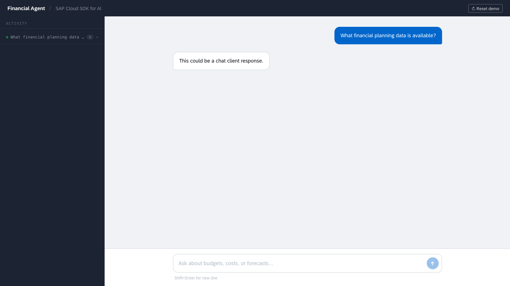

# Exercise 1 - Connecting to AI Core: Building a Chat Agent

In this exercise, you will connect a TypeScript application to an LLM via SAP AI Core.
You'll use the [SAP Cloud SDK for AI (JavaScript)](https://github.com/SAP/ai-sdk-js) and its [LangChain](https://js.langchain.com/) integration to build a working agent that can receive a user prompt and return an answer.

## What you'll learn

By the end of this exercise, your agent will be able to send a prompt to an LLM via SAP AI Core and return a response to the browser.
You'll understand how the `OrchestrationClient` class from `@sap-ai-sdk/langchain` replaces direct vendor API calls, how a model config array enables fallback (more on that in Exercise 4), and how LangChain's `createAgent()` function, running on LangGraph's runtime, drives the full request–response loop.

If you have any trouble solving the exercise, the solution code is commented out inside the [agent.ts](../../agent/src/agent.ts) file — look for the `/* */` blocks.

## Background: What is SAP Orchestration?

The SAP Cloud SDK for AI provides an _Orchestration_ layer that sits in front of multiple LLM providers (OpenAI, Anthropic, Google, and others) available through SAP AI Core's Generative AI Hub.
Instead of talking to a vendor API directly, your code uses a single harmonized API that handles content filtering, data masking, templating, grounding, and more.

In LangChain terms, this means you use the `OrchestrationClient` class (instead of, say, the `ChatOpenAI` class) and configure your model choice through a plain config object rather than an API key and model string.

## Step 1: Familiarize yourself with the project structure

Before writing any code, take a few minutes to read the files you'll be working with.

The project structure under `js-app/` is:

```text
js-app/
├── agent/
│   └── src/
│       ├── agent.ts          ← you will implement the agent here
│       ├── system-prompt.ts  ← system instructions for the agent
│       └── tools/
│           ├── odata-tools.ts    ← OData query tools
│           ├── sql-tool.ts       ← In-Memory SQL tool
│           ├── rpt-tool.ts       ← SAP RPT forecasting tool
│           ├── tabpfn-tool.ts    ← TabPFN prediction tool
│           └── get-ground-truth-tool.ts  ← accuracy evaluation tool
├── webui/                    ← React frontend (no changes needed)
└── exercises/                ← exercise guides
```

Open [agent/src/agent.ts](../../agent/src/agent.ts) and read it top to bottom.
Notice the following:

1. The **`buildFinancialAgent()`** function is the function you will implement.
   It is currently a stub. Build it out piece by piece in the following steps.

2. The [system-prompt.ts](../../agent/src/system-prompt.ts) file defines **`SYSTEM_PROMPT`**.
   The `systemPromptForTools(tools)` function in `agent.ts` wraps the prompt with a tool-boundary
   guardrail — it tells the model which tools are available in this run and forbids fabricating
   results from tools that are not. You do not need to change either.

3. The **`createAgent()`** function wires the model, tools, system prompt, and checkpointer together.
   Once set up, it handles the agentic loop — calling the model, executing tools, calling the model again — automatically.
   This workshop uses SQL as its only local analysis path: Exercise 2 registers OData loading tools and SQL reporting tools.


## Step 2: Create an `OrchestrationClient`

Find the `buildFinancialAgent()` function in the [agent.ts](../../agent/src/agent.ts) file.
The solution code is commented out inside the `/* */` block.
Restore it one piece at a time by following the steps in this exercise.

The `OrchestrationClient` class is the LangChain-compatible model class provided by the SAP Cloud SDK for AI.
It accepts an array of model config objects, where each object describes one LLM to try in priority order.

Create the client with a single model to start:

```typescript
const orchestrationClient = new OrchestrationClient([
  {
    promptTemplating: {
      model: {
        name: 'anthropic--claude-4.6-sonnet',
        params: { reasoning_effort: 'low' },
      },
    },
  },
]);
```

The config object's `promptTemplating.model.name` field is the model identifier used by SAP AI Core's Generative AI Hub.
The SDK reads credentials, resource group, and deployment details automatically from the environment — no secrets appear in your code.

## Step 3: Wire up `createAgent()`

Find the `createAgent()` function call in `buildFinancialAgent()`.
It currently has four placeholder values. Replace each placeholder with the variable computed above it:

- Replace `model: {} as never` with `orchestrationClient`, the `OrchestrationClient` instance you created in Step 2.
  This assigns the configured model client to the `model` parameter in the agent configuration.
- Replace `systemPrompt: 'TODO'` with `systemPrompt`, the value already computed by `systemPromptForTools(tools)`.
- Replace `tools: []` with `tools`, so the tools you register in Exercise 2 reach the agent.
- Replace `middleware: []` with `middleware`, which enables orchestration prompt caching.

The `tools` array itself stays empty for now — you will populate it in Exercise 2.

Your complete `buildFinancialAgent()` function should look like this:

```typescript
function buildFinancialAgent() {
  const orchestrationClient = new OrchestrationClient([
    {
      promptTemplating: {
        model: {
          name: 'anthropic--claude-4.6-sonnet',
          params: { reasoning_effort: 'low' },
        },
      },
    },
  ]);

  const tools: never[] = [];

  const systemPrompt = systemPromptForTools(tools);

  const middleware = [orchestrationPromptCachingMiddleware()];

  return createAgent({
    model: orchestrationClient,
    systemPrompt,
    checkpointer,
    tools,
    middleware,
  });
}
```

## Step 4: Start the application and test it

If the application is not already running, start it:

```bash
pnpm run js-agent
```

Navigate to http://localhost:3142/ and ask:

> "What financial planning data is available?"

You should see the agent respond.
At this point the agent has no tools, so it can only answer from its built-in knowledge and the system prompt.
It cannot query any real data source yet — that comes in Exercise 2.

> [!NOTE]
> If the reply is exactly "This could be a chat client response.", the agent is still running its placeholder model.
> Check that `createAgent()` receives the `OrchestrationClient` instance from Step 2 and that the development server reloaded.



## Step 5: Understanding what happened

When you submitted the query, the following happened:

1. The browser posted the prompt to the web server, which forwarded it to `getFinancialAgent()`.
2. The agent invoked the `OrchestrationClient` instance with the system prompt and user message.
3. The `OrchestrationClient` instance sent the request to the configured model via SAP Orchestration on AI Core.
4. The model's response was streamed back to the browser.

The entire setup — credentials, resource groups, and deployment IDs — was read automatically from the environment by the `OrchestrationClient` instance.
This is the same pattern you would use in a production BTP application: no secrets in code, only configuration in the environment.

## Step 6: Try a different model

> [!TIP]
> For the best experience, please revert back to `anthropic--claude-4.6-sonnet` after trying the other model.

To switch models, replace the existing entry in the config array.
Try `gemini-3.8-flash`:

```typescript
const orchestrationClient = new OrchestrationClient([
  { promptTemplating: { model: { name: 'gemini-3.8-flash' } } },
]);
```

Save the file and ask the same question.
The development server reloads automatically.
Notice how phrasing, verbosity, and response time change — the system prompt is identical, only the model is different.

## Summary

You have connected a TypeScript application to an LLM via SAP AI Core using the SAP Cloud SDK for AI.
The agent can now receive a user prompt, apply the financial analyst system prompt, and return the model's answer.

In Exercise 2 you will give the agent access to its data tools — OData services and an in-memory SQL workspace — so it can query and aggregate financial data.
Exercise 3 then adds the forecasting models.

Continue to [Exercise 2 - Equipping the Agent: Tool Calls and the Agentic Loop](../ex2/README.md).
