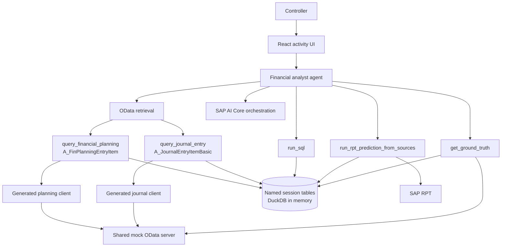

# RA160: finance data,<br>prediction, ground truth

## OData entities → session SQL → RPT → ground-truth comparison

<div class="mt-12 text-sm opacity-65">30 minutes · live demo · team discussion</div>

<!--
Walk through the concrete data path and the open choices around SQL and prediction.
Timing: 1 minute.
-->

---
layout: two-cols-header
---

# Current implementation

::left::

### Finance data access

- `A_FinPlanningEntryItem` from `API_FINPLANNINGENTRYITEM_SRV`
- `A_JournalEntryItemBasic` from `API_JOURNALENTRYITEMBASIC_SRV`
- Generated SAP Cloud SDK clients build typed `$filter` requests
- Filter fields: `CostCenter`, `LedgerFiscalYear`, `FiscalPeriod`

::right::

### Local analysis and prediction

- Filtered rows append to named DuckDB session tables
- `run_sql` handles joins and `GROUP BY`
- SAP RPT writes prediction rows back into a session table
- Current gaps: staged exercises, one prediction-tool contract, Java track details

<!--
Start with the concrete entities and data path rather than the agent framework.
Timing: 2 minutes.
-->

---
layout: statement
---

# Three questions in the demo

## 1. Can we access the finance rows? → 2. Can we analyze and predict? → 3. Can we check against ground truth?

<!--
These are the three parts of the demo story. Each needs a different data boundary.
Timing: 1 minute.
-->

---
layout: two-cols
layoutClass: gap-12
---

# Proposed exercise path

### 1. Access finance data

`A_FinPlanningEntryItem` provides plan/budget rows.<br>
`A_JournalEntryItemBasic` provides journal postings.

Use typed OData filters before loading any rows locally.

### 2. Analyze, then predict

SQL answers known values. RPT predicts a target column only for rows outside the known context.

::right::

### 3. Compare with ground truth

Fetch FY 2026 actual journal rows only after prediction; aggregate both paths **at the same grain** and join them.

### Why use SQL?

RPT benefits from having a context of >500 rows, and this could lead to accuracy issues in the LLM context.
In addition, without additional tooling, the model will have issues, e.g. moving from the item-level to the quarterly and monthly level.

<!--
The point is not “use an agent.” It is to distinguish querying known rows, predicting missing values, and checking that prediction.
Timing: 3 minutes.
-->

---
layout: iframe-right
url: http://localhost:3142
---

# Live walk-through — 5 minutes

1. **Report** — monthly actual spend for `A1000`, FY 2025
2. **Predict** — monthly 2026 spend from 2022–2025 actuals
3. **Compare** — forecast versus 2026 ground truth
4. Inspect the activity rail: OData → SQL → prediction → comparison

<div class="mt-8 text-sm opacity-70">
  Embedded from <code>http://localhost:3142</code>. Start the web UI before presenting; use a separate tab if framing is blocked.
</div>

<!--
The iframe is a convenience. Keep a browser tab open as fallback.
Point out the transition from retrieval to aggregation, prediction, and comparison.
Timing: 5 minutes.
-->

---
layout: two-cols
layoutClass: gap-12
---

# Run the demo locally

```sh
# JavaScript track — UI, agent, and integrated mock services
mise run webui
```

Open `http://localhost:3142`.

::right::

### Prerequisites

- Node.js 24 and pnpm 12
- `pnpm install` from the repository root
- SAP AI Core / Generative AI Hub credentials in local `.env`

### Optional standalone server

`mise run mock-server` is for direct OData/client work or a separately hosted mock service — it is **not** part of the normal JavaScript demo startup path.

<!--
For the JavaScript track, `mise run webui` is the normal one-command start. The credential prerequisite affects the agent, not the deterministic integrated mock services.
Timing: 2 minutes.
-->

---
layout: two-cols-header
---

# One scenario, with the implementation details visible

::left::

### 1. Report actual spend

```text
Show monthly actual spend for A1000 in FY 2025.
```

```text
GET A_JournalEntryItemBasic
$filter=CostCenter eq 'A1000'
  and LedgerFiscalYear eq '2025'
```

Then load `journal_2025` and run `GROUP BY fiscalPeriod` over `amountInCompanyCodeCurrency`.

::right::

### 2. Predict, then compare

- Context: `A_JournalEntryItemBasic`, FY 2022–2025
- Target rows: `A_FinPlanningEntryItem`, FY 2026
- Example target: `amountInCompanyCodeCurrency`
- Prediction output: `predicted_amountInCompanyCodeCurrency`
- `get_ground_truth` loads FY 2026 journal actuals and joins at `fiscalPeriod`

The check reports `pct_of_actual`, `pct_below_actual`, `pct_above_actual`, and MAPE.

<!--
The generated client uses typed field names; the shown GET is the equivalent request shape. The application logs this entity and filter before appending rows to the session table.
Timing: 3 minutes.
-->

---
layout: section
---

# Current architecture

## Service calls, local workspace, model call, and comparison

<!--
Timing: 30 seconds.
-->

---
layout: full
---

# Current architecture



<div class="text-sm opacity-70">The agent branches into retrieval, SQL, prediction, and evaluation. Filtered OData rows and prediction output meet in the session workspace; evaluation reloads actuals from the mock server.</div>

<!--
Read top to bottom. The only shared state is the session workspace and the mock server.
Timing: 2 minutes.
-->


---
layout: two-cols
layoutClass: gap-12
---

# Where SQL fits

### OData: fetch and filter

- Filter in the service: cost center, category, fiscal year
- Generated clients keep service access typed
- The two service roots cannot join in one ordinary OData query
- The mock server does **not** implement general `$apply` aggregation

::right::

### SQL: combine and regroup

- Join planning rows, journal rows, and prediction output
- Aggregate at the requested grain: month, quarter, cost center
- Query prediction rows that are not OData entities
- Show the query that calculated the result

<div class="mt-8 rounded border border-amber-300/40 bg-amber-300/10 p-4">
  After prediction, monthly/quarterly regrouping needs SQL, a new endpoint, or another fixed-purpose tool.
</div>

<!--
This is not a general claim that local SQL is always preferable. It covers cross-service joins and session-local prediction rows in this demo.
Timing: 3 minutes.
-->

---
layout: two-cols
layoutClass: gap-12
---

# `run_sql` today

```ts {1|3-7|9-14|all} twoslash
// @errors: 2304

type SqlInput = { sql: string }
type SessionRow = Record<string, unknown>

declare function runQuery(
  sql: string,
): Promise<SessionRow[]>

async function runSql({ sql }: SqlInput) {
  // 15-second query timeout; serialized workspace access
  return runQuery(sql)
}
```

::right::

### Current contract

- Tool name: `run_sql`
- Reporting: `WHERE`, `JOIN`, `GROUP BY`, aggregates
- Windows and regression aggregates are available for labeled SQL baselines
- Rows return as JSON in the activity stream

### Boundaries to keep or add

- Session-scoped tables
- Named loaded tables and shown SQL
- Timeout and cleanup
- Same filters + same grain before forecast/actual comparison

<!--
Twoslash shows the TypeScript shapes without expanding into a framework section.
Current code serializes DuckDB access and uses a 15-second timeout. The tool currently forwards SQL directly; read-only access is a boundary to decide and enforce.
Timing: 3 minutes.
-->

---
layout: two-cols-header
---

# RPT: known context, prediction rows, and output

::left::

### Current demo: two source tables

```ts
run_rpt_prediction_from_sources({
  contextTable: 'journal_actuals_2022_2025',
  predictionTable: 'planning_targets_2026',
  targetColumn: 'amountInCompanyCodeCurrency',
  taskType: 'regression',
  outputTable: 'forecast_2026',
})
```

- Only shared columns enter RPT.
- The tool adds `source: actual | plan`.
- It keeps the actual target values and nulls the target column on plan rows.
- `forecast_2026` gets `predicted_<target>` plus confidence columns.

::right::

### Single table or a view

`run_rpt_prediction` accepts a named session table **or** a named view.

- A view is a saved `SELECT`; it does not copy data. Use it to join, union, project, or filter before prediction.
- `predictionWhere` is a SQL predicate **without** `WHERE`; it selects target rows.
- `contextWhere` is optional. If omitted, context is `NOT (predictionWhere)`.
- Use the two-source tool when actuals and planning rows are separate tables.

```text
predictionWhere:
ledgerFiscalYear = '2026' AND fiscalPeriod IN ('010', '011', '012')
```

<!--
Make the split explicit. A prediction is not “run RPT on a table”: it is run with known target values in context and target rows whose value is nulled before the model call.
Timing: 2 minutes.
-->

---
layout: two-cols-header
---

# SQL scope and constraints

::left::

### What it is

- In-memory DuckDB in the TypeScript process (analytical DB, PostgreSQL dialect)
- Session workspace for the demo/workshop
- Local shaping of filtered business rows and prediction output

### What it is not

- A SAP DB (HANA)
- A production persistence tier
- A replacement for source-side aggregation where the API supports it

::right::

### Constraints

- Source rows are copied into process memory
- Free-form SQL needs execution limits and a read-only policy
- Java should also have good support for in-memory SQL, e.g. SQLite

<div class="mt-8 rounded border border-rose-300/40 bg-rose-300/10 p-4">
  For large datasets, filter and aggregate at the source when the service can express the question. Do not load an unbounded dataset for local SQL.
</div>

<!--
Call it DuckDB, not HANA. It fills gaps in the current mock/API shape; it is not a production data-layer proposal.
Timing: 2 minutes.
-->

---
layout: two-cols
layoutClass: gap-12
---

# Other options

### OData aggregation/pushdown

Use when the service can express the filter and aggregation.

**Missing here:** joins across the two roots, regrouping session-local RPT output, and `$apply` in the mock.

### Fixed-purpose business tools

Narrow tool surface.

**Trade-off:** a new analytical question often means another tool.

::right::

### Sandboxed JavaScript

Option: [@langchain/quickjs](https://npmx.dev/package/@langchain/quickjs).

**Use:** flexible transformations without teaching SQL.

**Extra work:** sandboxing, resource limits, dependency policy, generated-code review, error reporting, and provenance.

<div class="mt-10 rounded border border-cyan-300/40 bg-cyan-300/10 p-4">
  Suggested order: begin with limited SQL. Revisit a QuickJS interpreter as a separate experiment.
</div>

<!--
QuickJS is a different topic: executing generated code safely. It adds operational concerns beyond limited SQL.
Timing: 3 minutes.
-->

---
layout: two-cols-header
---

# SQL scope for the first workshop pass

::left::

### Start here

1. Retrieve filtered OData rows
2. Load named session tables
3. `SELECT`, `WHERE`, `GROUP BY`, `SUM`
4. Join at a stated grain
5. Show the query and result in the activity rail

### Checkpoint

Can we trace each result back to the input rows and query?

::right::

### Follow-up candidates

- SQL baseline: carry-forward, moving average, simple regression
- Compare baseline and tabular model against the same actuals
- QuickJS: code execution and provenance
- Java: same tools, prompts, output grain, and metrics; different framework internals allowed

<!--
Keep advanced SQL, model configuration, sandboxing, and Java details out of the first exercise pass.
Timing: 2 minutes.
-->

---
layout: two-cols-header
---

# Open implementation issues

::left::

### Tool and data contract

- Replace `run_rpt_prediction` and `run_rpt_prediction_from_sources` with single tool
- State that actuals are excluded by workflow, not server controls
- Compare prediction and actual using identical filters and grain

::right::

### Exercise delivery

- Create staged starter/solution states from the completed reference
- Check SAP AI Core credentials, entitlement, and model availability
- Document ports, connectivity, model failures, and participant-owned credentials
- Package the mock-server as one command/container e.g. via `bun --compile` for Java track

<!--
These are the remaining implementation and exercise-authoring tasks.
Timing: 2 minutes.
-->

---
layout: end
---

# Q / A

<div class="mt-12 text-sm opacity-70">
  Demo: <code>http://localhost:3142</code> · Deck: <code>slides/slides.md</code>
</div>

<!--
Leave this visible for discussion. The iframe is local presenter convenience; use the browser-tab fallback if needed.
-->

